<p align="center">
  <picture>
    <source media="(prefers-color-scheme: dark)" srcset="branding/oceanic-logo-transparent.png" />
    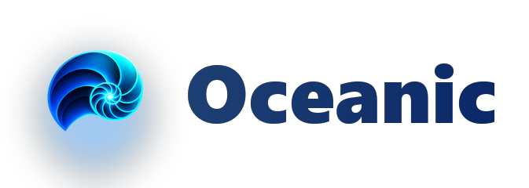
  </picture>
</p>

<h1 align="center">Oceanic</h1>
<p align="center"><b>Your calm, all-in-one study space, now with Nerida AI.</b><br/>Free, offline-first, and made for students.</p>

<p align="center">
  <a href="https://github.com/MystiTheDev/oceanic/releases/latest"></a>
  <a href="https://github.com/MystiTheDev/oceanic/stargazers"></a>
  
  
</p>

<p align="center">
  <a href="https://github.com/MystiTheDev/oceanic/releases/latest"></a>
</p>

<p align="center">
  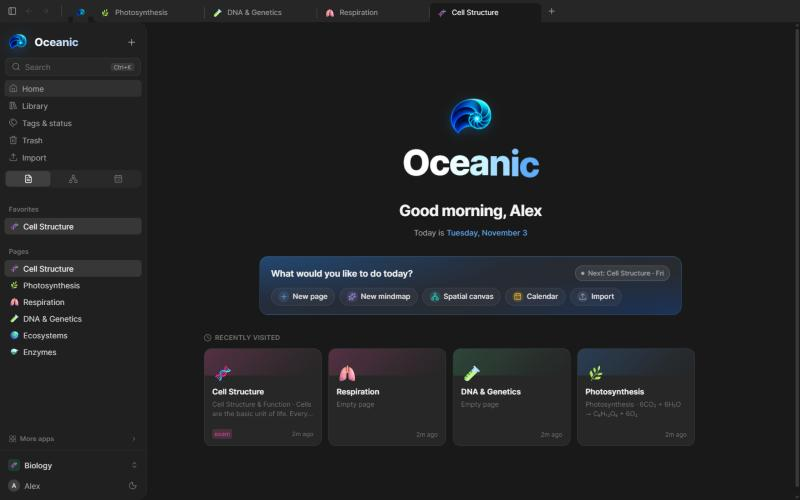<br/>
  <sub><b>Study Home:</b> pick up right where you left off</sub>
</p>

---

Oceanic brings your notes, writing, mind maps, sketches and calendar into one app, so you can stop switching between tools and just study. There's no account, no cloud lock-in, and no subscription.

## Meet Nerida, your study buddy

Nerida is the AI built right into Oceanic. She reads your notes so you don't have to copy-paste anything.

- **Ask anything.** Chat with Nerida about the page you're on, and she uses your related notes for context.
- **Edit with Nerida.** Select text and ask her to rewrite, shorten, explain or fix it.
- **Quizzes and flashcards.** Turn any note or selection into flashcards and practice questions.
- **Ask your PDFs.** Highlight part of a PDF and ask Nerida about it, or turn it into a note.
- **Grow mind maps.** Give Nerida a topic and she branches it out for you.
- **Spots your deadlines.** Mention "essay due Friday" and Nerida offers to add it to your calendar.

**Private by default.** Nerida runs on your own computer with a local model (llama.cpp or Ollama), so your notes never leave your device and it works offline. Want a bigger model? You can optionally connect OpenAI, Gemini, Groq or OpenRouter with your own API key.

<p align="center">
  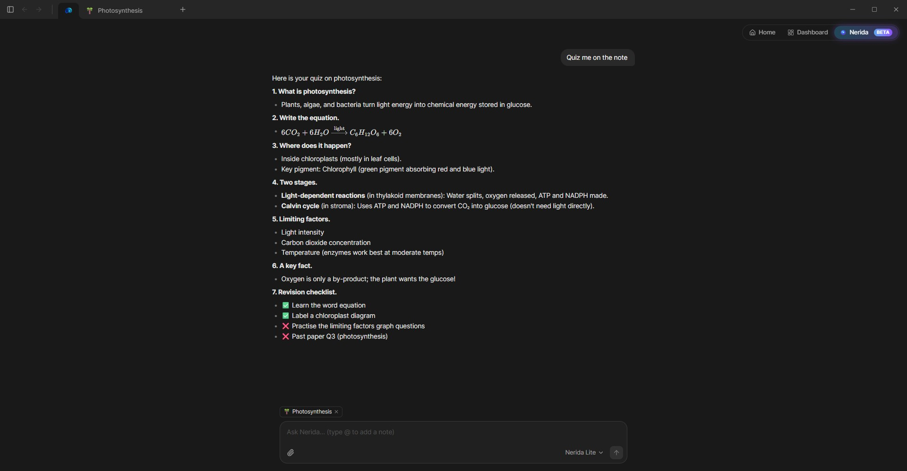<br/>
  <sub><b>Nerida:</b> ask, edit and study with AI, right next to your notes</sub>
</p>

## Four apps in one

| | |
|---|---|
| **Oceanic Notes** | Block-based notes with to-dos, toggles, tables, code, quotes, audio and more |
| **Oceanic Docs** | A focused writing space for essays and assignments |
| **Oceanic Mindmap** | Map out tricky topics visually |
| **Oceanic Sketch** | Draw diagrams, graphs and doodles freely |

<p align="center">
  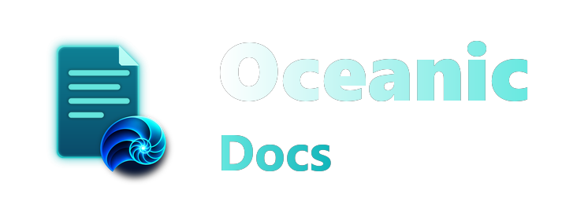
  &nbsp;&nbsp;
  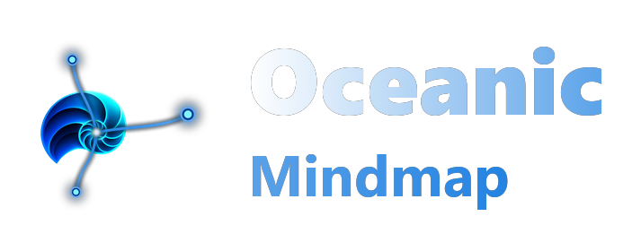
  &nbsp;&nbsp;
  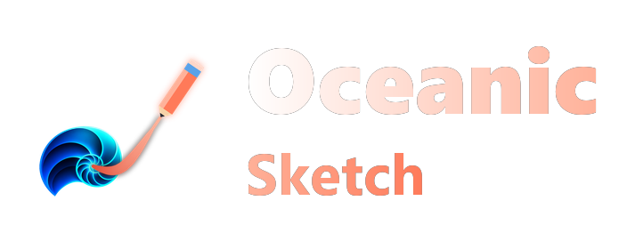
</p>

## A peek inside

<table>
  <tr>
    <td align="center" width="33%">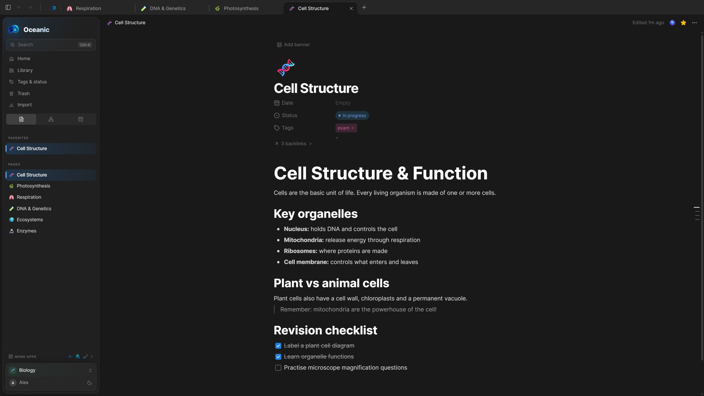<br/><sub><b>Notes:</b> headings, lists, quotes and checklists</sub></td>
    <td align="center" width="33%">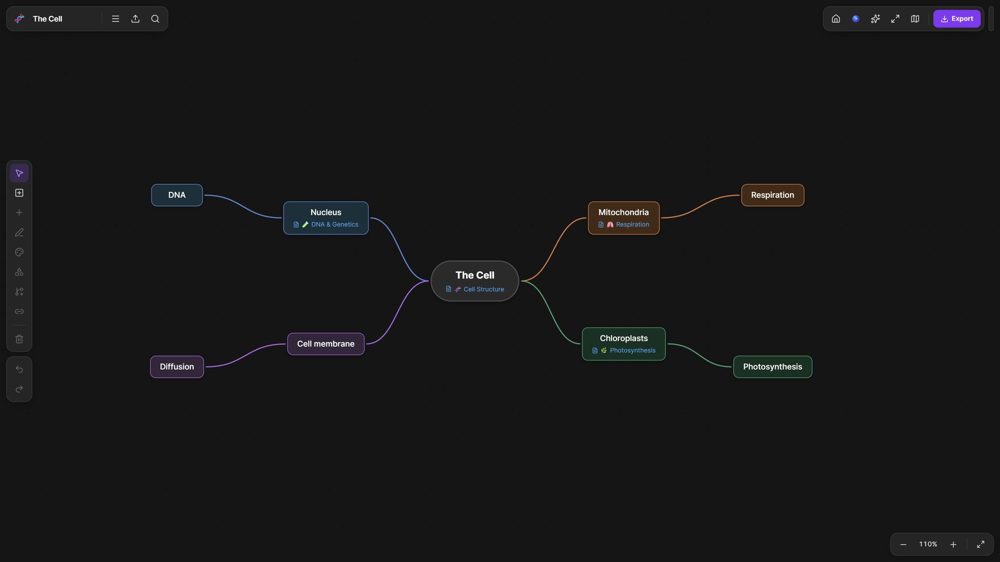<br/><sub><b>Mind maps:</b> break big topics into small ideas</sub></td>
    <td align="center" width="33%">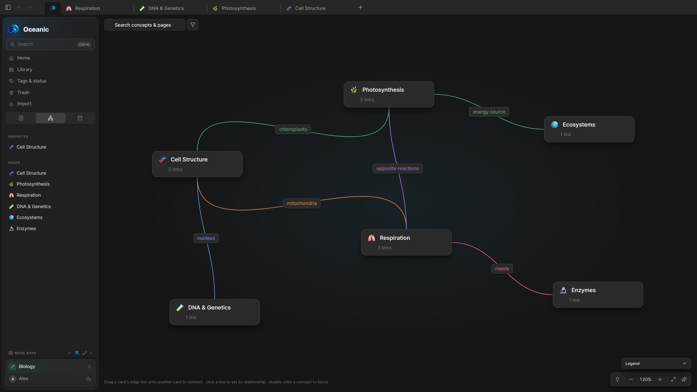<br/><sub><b>Spatial canvas:</b> see how your topics connect</sub></td>
  </tr>
  <tr>
    <td align="center">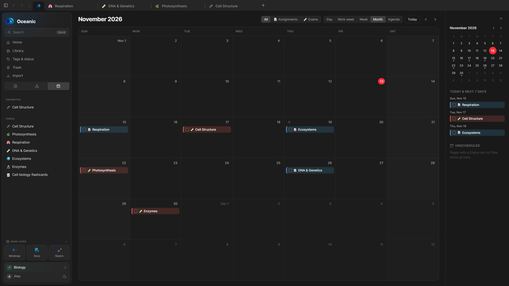<br/><sub><b>Calendar:</b> deadlines, tests and study plans</sub></td>
    <td align="center">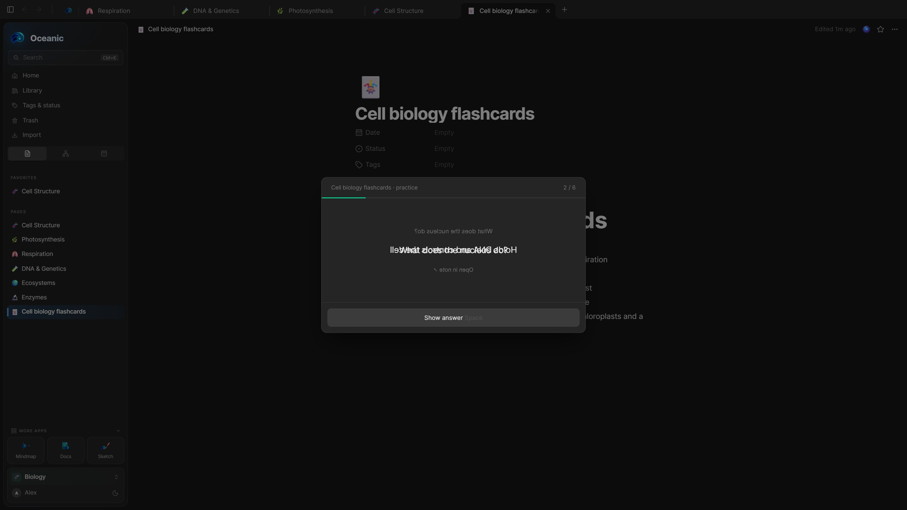<br/><sub><b>Flashcards:</b> practise what you just wrote</sub></td>
    <td></td>
  </tr>
</table>

## Why Oceanic

- **Your notes stay on your computer.** Everything is saved to a folder you choose. It opens instantly and works without internet.
- **Ready for school.** It comes set up for Maths, Physics, Chemistry, Biology, History, Languages and more.
- **Three ways to view a workspace.** Switch between **Document**, **Calendar** and **Spatial Canvas** views.
- **Connected notes.** Backlinks, page peeks and auto-generated outlines.
- **Fast and light.** It's a native desktop app that stays smooth with hundreds of pages.
- **No lock-in.** Export to **PDF**, **Markdown** or **HTML** anytime, or as an **.ocean** file that keeps everything. Send it to a friend and they can double-click it to open.
- **Make it yours.** Pick an accent colour and profile picture, change the text size, and choose which day your week starts on.
- **Hard to lose work.** Deleted pages go to the Trash first.
- **AI that respects you.** Nerida is optional, local-first, and never needs an account.

### How it compares

| | Oceanic | Typical cloud notes app |
|---|:---:|:---:|
| Works fully offline | ✅ | ❌ |
| Free, no subscription | ✅ | Often limited |
| No account needed | ✅ | ❌ |
| Built-in AI that can run locally | ✅ | ❌ |
| Notes, docs, mind maps and sketches in one app | ✅ | Rarely |
| Your files in a folder you own | ✅ | ❌ |

## Safety and privacy

- **No tracking.** Oceanic has no account, no ads and no analytics.
- **Imported files are scanned.** On Windows, notes and zip files you import are checked by your installed antivirus first. If it flags something, the import stops and Oceanic warns you.
- **Locked-down file access.** The app can only open folders and files you picked yourself.
- **Nerida can't be tricked by your files.** Text in notes, PDFs or web results that tries to give Nerida orders is filtered out. Her answers cite which source each fact came from.

## Download

Get the latest version from the **[Releases page](https://github.com/MystiTheDev/oceanic/releases/latest)**.

| Platform | File |
|---|---|
| **Windows** | `Oceanic_x.x.x_x64-setup.exe` |
| **macOS** (Apple Silicon and Intel) | `Oceanic_x.x.x_universal.dmg` |
| **Linux** | `.AppImage`, `.deb` or `.rpm` |

> **Heads up:** Oceanic isn't code-signed yet, so your system may warn you the first time.
> - **Windows:** click **More info → Run anyway**.
> - **macOS:** right-click the app, then choose **Open**.

> **Antivirus false positives:** the Windows installer is an unsigned NSIS installer, so some antivirus products (notably Norton) may flag it as `NSIS`/`NSIS/Injector`. Each release includes a `SHA256SUMS-Windows.txt` file — verify the installer hash against it, then in Norton open **Security → History**, select the detection and choose **Allow/Exclude**. If the in-app updater's temporary download is blocked, pause Auto-Protect briefly, let the update finish, then turn it back on. Please also submit the file to Norton as a false positive.

> **LAN sync on Windows:** Oceanic no longer changes Windows Firewall during install. If pairing fails, allow the app through the firewall for **Private** networks (TCP 47823).

Oceanic updates itself when a new version is out. You can see what's new on the **[Releases page](https://github.com/MystiTheDev/oceanic/releases)**.

### System requirements

| | Minimum |
|---|---|
| **Windows** | Windows 10 or 11, 64-bit |
| **macOS** | Apple Silicon or Intel Mac |
| **Linux** | A modern 64-bit distro (Ubuntu 22.04 or newer recommended) |
| **Memory** | 4 GB RAM for Oceanic on its own |
| **Nerida (local AI)** | 8 GB RAM minimum, 16 GB suggested, plus a few GB of disk for the model |

Cloud AI providers don't need extra RAM, only an internet connection.

## Getting started

1. Install and open Oceanic.
2. Pick a folder for your notes.
3. Start studying. ✨

## FAQ

<details>
<summary><b>Is Oceanic really free?</b></summary>

Yes. No account, no subscription, no ads.
</details>

<details>
<summary><b>Does Nerida need the internet?</b></summary>

No. With a local model (llama.cpp or Ollama) she works fully offline. Only cloud providers you choose to connect need internet.
</details>

<details>
<summary><b>Do my notes get sent anywhere?</b></summary>

Not unless you connect a cloud AI provider yourself. Otherwise everything stays in the folder you picked.
</details>

<details>
<summary><b>Where are my files?</b></summary>

In the notes folder you chose on first launch. They're yours, and you can export them anytime.
</details>

<details>
<summary><b>My computer is slow. Can I still use Nerida?</b></summary>

Yes. Pick a smaller local model, or connect a cloud provider with your own API key so the work happens off your computer.
</details>

<details>
<summary><b>Why does Windows or macOS warn me when I install it?</b></summary>

Oceanic isn't code-signed yet. Signing costs money every year, and Oceanic is free. See the steps under **Download** to open it anyway. If Norton flagged the installer as `NSIS`/`NSIS/Injector`, verify it with `SHA256SUMS-Windows.txt` on the release page, then allow it from **Security → History** and submit it as a false positive.
</details>

<details>
<summary><b>Can I share notes with a friend?</b></summary>

Yes. Export a page as an **.ocean** file and send it. They can double-click it to open it in Oceanic.
</details>

## What's next

- **Oceanic on mobile**, once the desktop features are finished.
- More study tools around flashcards and spaced practice.
- Have an idea? **[Suggest it](https://github.com/MystiTheDev/oceanic/issues)**.

## Feedback and bugs

Found a bug or have an idea? **[Open an issue](https://github.com/MystiTheDev/oceanic/issues)**. I read every one.

<details>
<summary><b>Build from source</b></summary>

You need [Node.js](https://nodejs.org) 20+, [Rust](https://rustup.rs) and the [Tauri prerequisites](https://tauri.app/start/prerequisites/) for your system.

```bash
git clone https://github.com/MystiTheDev/oceanic.git
cd oceanic
npm install
npm run tauri dev
```

To build an installer, run `npm run tauri build`.
</details>

---

## About

I made Oceanic myself, because studying shouldn't mean juggling a notes app, a drawing app, a mind-map tool, a calendar and a word processor. Every tool I tried was either built for office teams or locked my notes in the cloud, so I built the one I wanted.

Oceanic is designed, built and maintained by one person: **[@MystiTheDev](https://github.com/MystiTheDev)**. If it helps you, a ⭐ on the repo means a lot.

## License

© 2026 MystiTheDev. All rights reserved.

The source code is public so you can read it, learn from it and build it for yourself. It is not open source: you may not copy, change, redistribute or sell it without written permission. See [LICENSE](LICENSE) for the full terms.

<p align="center"><i>Made with care for students everywhere. 🌊</i></p>
