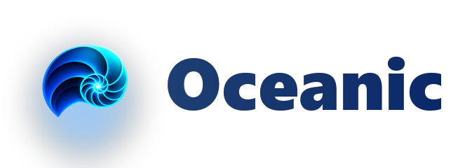
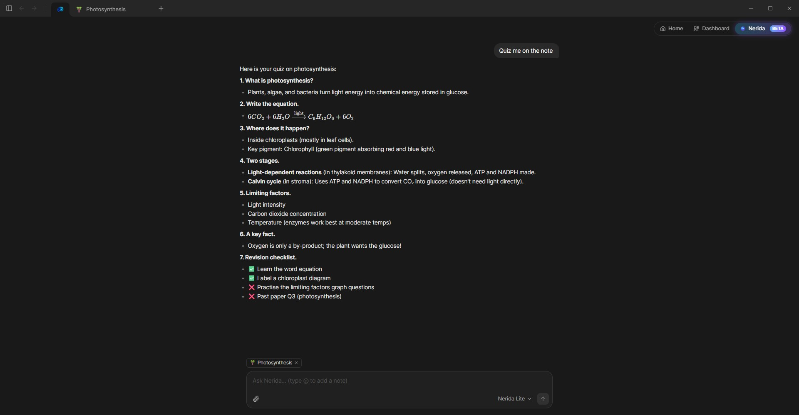
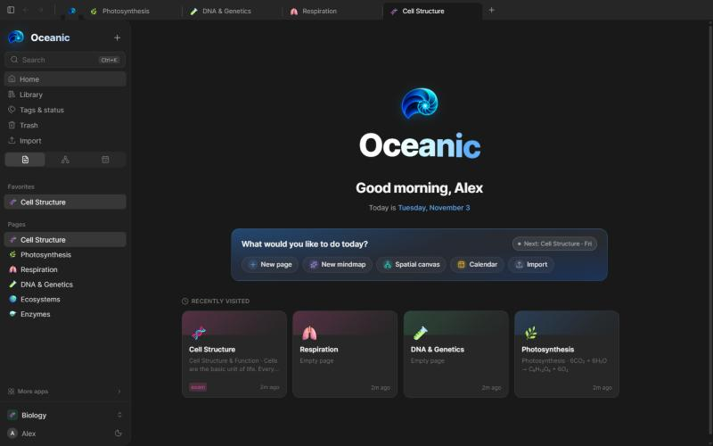
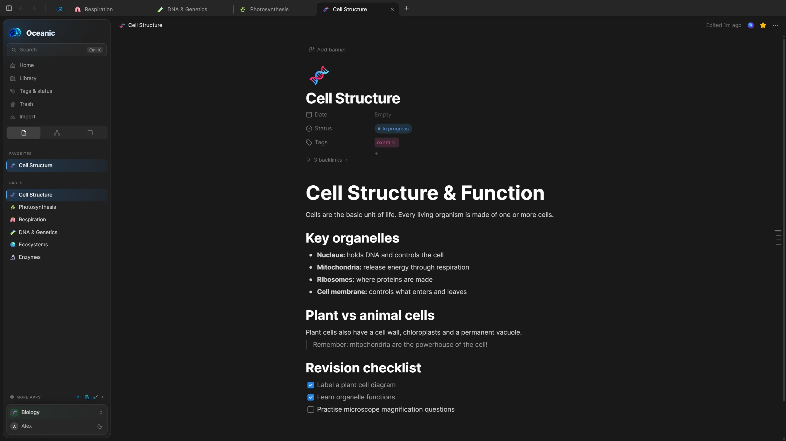
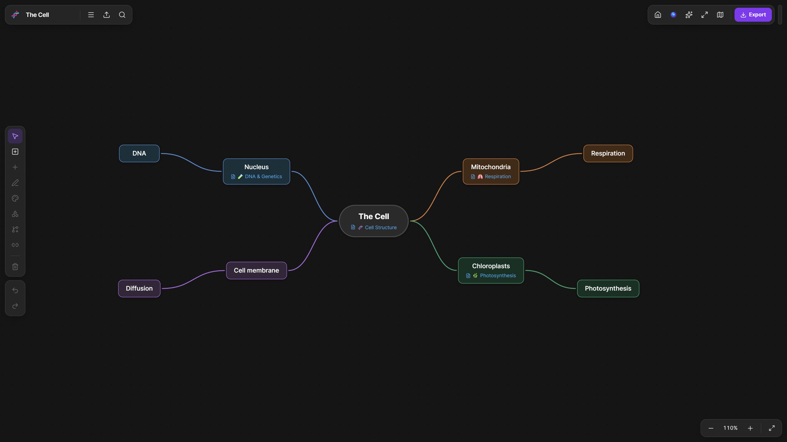
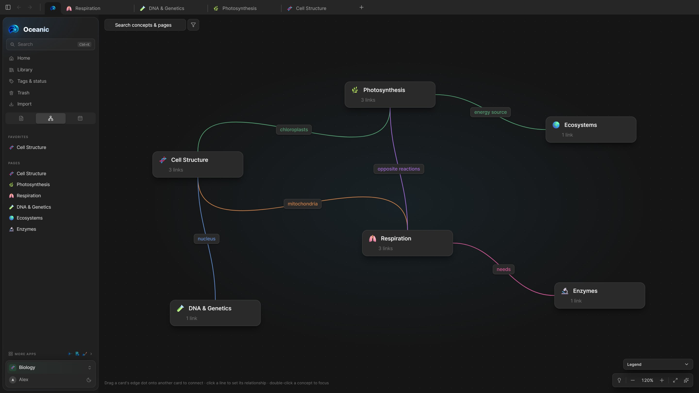

  <picture>
    <source media="(prefers-color-scheme: dark)" srcset="branding/oceanic-logo-transparent.png" />
    
  </picture>

<h1 align="center">Oceanic</h1>

<b>Your calm, all-in-one study space, now with Nerida AI.</b> Free, offline-first, and made for students.

  
  
  
  

  

---

Oceanic brings your notes, writing, mind maps, sketches and calendar into one app, so you can stop switching between tools and just study. There's no account, no cloud lock-in, and no subscription.

## 🐚 Meet Nerida, your study buddy

Nerida is the AI built right into Oceanic. She reads your notes so you don't have to copy-paste anything.

- 💬 **Ask anything.** Chat with Nerida about the page you're on, and she uses your related notes for context.
- ✍️ **Edit with Nerida.** Select text and ask her to rewrite, shorten, explain or fix it.
- 🃏 **Quizzes & flashcards.** Turn any note or selection into flashcards and practice questions.
- 📑 **Ask your PDFs.** Highlight part of a PDF and ask Nerida about it, or turn it into a note.
- 🧠 **Grow mind maps.** Give Nerida a topic and she branches it out for you.
- 📅 **Spots your deadlines.** Mention "essay due Friday" and Nerida offers to add it to your calendar.

**Private by default.** Nerida runs on your own computer with a local model (llama.cpp or Ollama), so your notes never leave your device and it works offline. Want a bigger model? You can optionally connect OpenAI, Gemini, Groq or OpenRouter with your own API key.

   
  <b>🐚 Nerida:</b> ask, edit and study with AI, right next to your notes

## 🧰 Four apps in one

| | |
|---|---|
| 📝 **Oceanic Notes** | Block-based notes with to-dos, toggles, tables, code, quotes, audio and more |
| 📄 **Oceanic Docs** | A focused writing space for essays and assignments |
| 🧠 **Oceanic Mindmap** | Map out tricky topics visually |
| ✏️ **Oceanic Sketch** | Draw diagrams, graphs and doodles freely |

  
  &nbsp;&nbsp;
  
  &nbsp;&nbsp;
  

## 🖼️ A peek inside

<table>
  <tr>
    <td align="center"> <b>🏠 Study Home:</b> pick up right where you left off</td>
    <td align="center"> <b>📝 Notes:</b> headings, lists, quotes and checklists</td>
  </tr>
  <tr>
    <td align="center"> <b>🧠 Mind maps:</b> break big topics into small ideas</td>
    <td align="center"> <b>🗺️ Spatial canvas:</b> see how your topics connect</td>
  </tr>
</table>

## 🌟 Why Oceanic

- 💾 **Your notes stay on your computer.** Everything is saved to a folder you choose. It opens instantly and works without internet.
- 🎒 **Ready for school.** It comes set up for Maths, Physics, Chemistry, Biology, History, Languages and more.
- 🗺️ **Three ways to view a workspace.** Switch between **Document**, **Calendar** and **Spatial Canvas** views.
- 🔗 **Connected notes.** Backlinks, page peeks and auto-generated outlines.
- ⚡ **Fast and light.** It's a native desktop app that stays smooth with hundreds of pages.
- 📤 **No lock-in.** Export to **PDF**, **Markdown** or **HTML** anytime, or as an **.ocean** file that keeps everything. Send it to a friend and they can double-click it to open.
- 🎨 **Make it yours.** Pick an accent colour and profile picture, change the text size, and choose which day your week starts on.
- 🛟 **Hard to lose work.** Deleted pages go to the Trash first.
- 🐚 **AI that respects you.** Nerida is optional, local-first, and never needs an account.

## ⬇️ Download

Get the latest version from the **[Releases page](https://github.com/MystiTheDev/oceanic/releases/latest)**.

| Platform | File |
|---|---|
| 🪟 **Windows** | `Oceanic_x.x.x_x64-setup.exe` |
| 🍎 **macOS** (Apple Silicon) | `Oceanic_x.x.x_aarch64.dmg` |
| 🐧 **Linux** | `.AppImage`, `.deb` or `.rpm` |

> **Heads up:** Oceanic isn't code-signed yet, so your system may warn you the first time.
> - **Windows:** click **More info → Run anyway**.
> - **macOS:** right-click the app, then choose **Open**.

Oceanic updates itself when a new version is out. You can see what's new on the **[Releases page](https://github.com/MystiTheDev/oceanic/releases)**.

## 🚀 Getting started

1. Install and open Oceanic.
2. Pick a folder for your notes.
3. Start studying. ✨

## ❓ FAQ

**Is Oceanic really free?**
Yes. No account, no subscription, no ads.

**Does Nerida need the internet?**
No. With a local model (llama.cpp or Ollama) she works fully offline. Only cloud providers you choose to connect need internet.

**Do my notes get sent anywhere?**
Not unless you connect a cloud AI provider yourself. Otherwise everything stays in the folder you picked.

**Where are my files?**
In the notes folder you chose on first launch. They're yours, and you can export them anytime.

## 🛣️ What's next

- 📱 **Oceanic on mobile**, once the desktop features are finished.
- 🃏 More study tools around flashcards and spaced practice.
- 💡 Have an idea? **[Suggest it](https://github.com/MystiTheDev/oceanic/issues)**.

## 💬 Feedback and bugs

Found a bug or have an idea? **[Open an issue](https://github.com/MystiTheDev/oceanic/issues)**. I read every one.

---

## 💙 About

I made Oceanic myself, because studying shouldn't mean juggling a notes app, a drawing app, a mind-map tool, a calendar and a word processor. Every tool I tried was either built for office teams or locked my notes in the cloud, so I built the one I wanted.

Oceanic is designed, built and maintained by one person: **[@MystiTheDev](https://github.com/MystiTheDev)**. If it helps you, a ⭐ on the repo means a lot.

<i>Made with care for students everywhere. 🌊</i>

