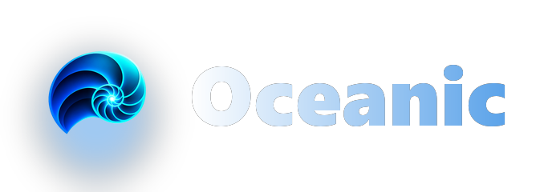
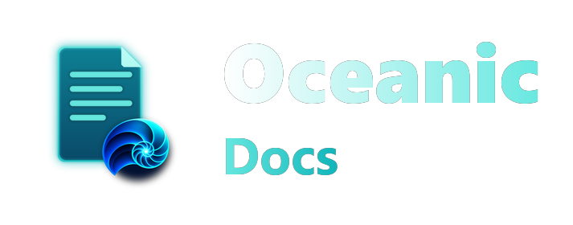
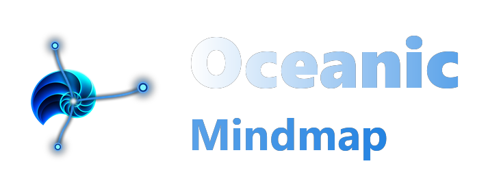
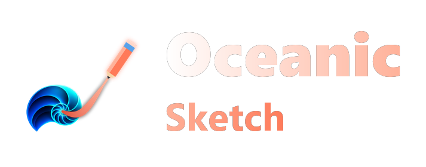

  <!-- 🌊 Main logo: swap in your final logo here -->
  

<h1 align="center">Oceanic</h1>

<i>Your calm, all-in-one study space.</i>

  <!-- 🎨 Banner / screenshot space: add a hero image or app screenshot here -->
  <!--  -->

---

## 👋 Hey, I'm glad you're here

I made Oceanic myself because studying shouldn't mean switching between a notes app, a drawing app, a mind-map tool, a calendar and a word processor. Every tool I tried was either built for office teams or locked my notes away in the cloud.

So I built the study app I wanted: one that's **made for students**, **works on your own computer**, and **stays out of your way**.

---

## 🌟 Why Oceanic feels different

### 💾 Your notes live on *your* computer
No account to sign up for, and no waiting for things to load. Everything is saved to a folder you choose, so your notes open instantly and keep working without the internet.

### 🎒 Built for school
Oceanic comes ready for real subjects: Maths, Physics, Chemistry, Biology, History, Geography, Economics, Computing, Art, Music, Languages and more. You don't have to build a system from scratch before you can start studying.

### 🧰 Four apps in one
| | |
|---|---|
| 📝 **Oceanic Notes** | Block-based notes with to-dos, toggles, tables, code, quotes, audio and more |
| 📄 **Oceanic Docs** | A focused writing space for essays and assignments |
| 🧠 **Oceanic Mindmap** | Map out tricky topics visually |
| ✏️ **Oceanic Sketch** | Draw diagrams, graphs and doodles freely |

Mind maps, tables and audio clips can sit right inside your notes. You don't need extra add-ons or a separate subscription.

### 🗺️ Think in space, not just in lists
Switch any workspace between **Document**, **Calendar** and **Spatial Canvas** views. The canvas lets you spread ideas out like sticky notes on a desk.

### 🔗 Notes that connect themselves
Backlinks, page peeks and auto-generated outlines help you see how your topics fit together.

### ⚡ Fast and lightweight
Oceanic is a native desktop app, so it's quick to open, light on memory and smooth even with hundreds of pages.

### 📤 Export without lock-in
Export pages as **PDF**, **Markdown** or **HTML** whenever you like. Your work is never trapped.

### 🛟 Hard to lose work
Deleted pages go to the Trash first, so you can bring them back anytime.

---

## 🖼️ A peek inside

<!-- 📸 Screenshot space: add app screenshots here -->

  <!--  -->
  <!--  -->

---

## 🧩 The Oceanic family

  
  &nbsp;&nbsp;
  
  &nbsp;&nbsp;
  

---

## 🚀 Getting started

1. Download the latest installer from the **Releases** page.
2. Install and open Oceanic.
3. Pick a folder for your notes.
4. Start studying. ✨

See [RELEASE_NOTES.md](RELEASE_NOTES.md) for what's new.

---

## 💙 About

Oceanic is designed, built and maintained by **one person**: me. If you have feedback, ideas or bug reports, I'd love to hear them.

<i>Made with care for students everywhere. 🌊</i>

